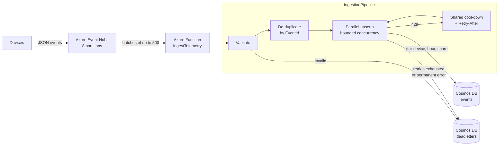

# Azure Telemetry Ingestion — Event Hubs → Functions → Cosmos DB

[](https://github.com/nitanandsinghupw/azure-telemetry-ingestion/actions/workflows/ci.yml)


A reference implementation of a high-volume device telemetry pipeline on Azure, built around the
problems that show up in production: **hot partitions, 429 throttling, duplicate events and data loss**.

It includes a load simulator that reproduces a hot-partition incident and shows the fix, a unit-tested
core library with no Azure dependencies, an Azure Functions host, and Bicep infrastructure.

## The problem it solves

A common first design uses the device ID as the Cosmos DB partition key. It works until one device (or a
few) sends most of the traffic. All of its writes land on one physical partition, that partition runs out of
RU/s, Cosmos DB starts returning **429 Too Many Requests**, latency climbs, and scaling the whole container
up to fix one partition gets expensive.

Running the included simulator (6,000 events, 20 devices, one device sending 60% of traffic):

| Partition key strategy | Time | 429s | Written | Dead-lettered | Busiest partition |
|---|---:|---:|---:|---:|---:|
| `deviceId` (naive) | 2.89 s | 357 | 6,000 | 0 | 71% of writes |
| `deviceId\|hour\|shard(8)` | **1.04 s** | **16** | 6,000 | 0 | **26% of writes** |

About 2.8× faster with roughly 10–25× fewer throttled requests across runs, on the same simulated capacity. With a perfect
spread, the busiest of 4 partitions would carry 25%.

```bash
dotnet run --project samples/LoadSimulator
```

## Architecture



## Design decisions

**1. Synthetic partition key: `{deviceId}|{hour}|{shard}`**
The time bucket bounds each logical partition (Cosmos DB caps one at 20 GB) and rotates writes onto new
partitions over time. The shard spreads a single busy device across several logical partitions, and
therefore across physical partitions. The trade-off is on reads: one device-hour needs `ShardCount` point
queries or one fan-out query, so `ShardCount` should be chosen from the hottest device's write rate.
See [`BucketedPartitionKeyStrategy`](src/TelemetryIngestion.Core/Partitioning/BucketedPartitionKeyStrategy.cs).

**2. A stable hash, never `string.GetHashCode()`**
.NET randomises `string.GetHashCode()` per process, so the same event would map to a different shard after a
restart. The shard uses FNV-1a, and a unit test pins its output.

**3. Idempotent writes instead of a de-duplication store**
Event Hubs delivers at least once. The document `id` is the `EventId`, and writes are upserts, so a replayed
event overwrites itself instead of creating a duplicate. Duplicates inside one batch are also dropped
before writing, to save RUs.

**4. 429 handling: Retry-After plus a shared cool-down**
When Cosmos DB says how long to wait, that wins over any backoff formula. And when one write is throttled,
every concurrent writer pauses (see [`ThrottleGate`](src/TelemetryIngestion.Core/Resilience/ThrottleGate.cs)),
because the other writers are usually hitting the same saturated partition. A little jitter after the
cool-down stops them all retrying at the same instant. The Cosmos SDK's own 429 retries are turned off so
the pressure isn't hidden from the pipeline.

**5. No data loss: written or dead-lettered, then checkpoint**
The Event Hubs checkpoint only moves forward when the function returns, and the pipeline only returns once
every event is either stored or in the dead-letter container with a reason (`Invalid`, `Unreadable`,
`RetriesExhausted`, `PermanentStoreError`). If the dead-letter write itself fails, the batch fails and is
retried, which is safe because of point 3.

**6. RU cost: index only what is queried**
The container indexes `deviceId`, `timestamp` and `metricName` and excludes everything else. On a
write-heavy workload, every indexed property costs RUs on every single write. Bulk mode and
`EnableContentResponseOnWrite = false` cut request overhead further.

## Project layout

```
src/TelemetryIngestion.Core        Pipeline, partitioning, retries. No Azure dependencies, fully unit-tested.
src/TelemetryIngestion.Functions   Azure Functions (isolated worker): Event Hubs trigger, Cosmos DB stores.
tests/TelemetryIngestion.Core.Tests xUnit tests for partitioning, retry policy and pipeline guarantees.
samples/LoadSimulator              Reproduces the hot-partition problem against a simulated Cosmos DB.
infra/main.bicep                   Event Hubs, Cosmos DB (autoscale), Function App, storage.
```

## Run it

Requires the [.NET 8 SDK](https://dotnet.microsoft.com/download/dotnet/8.0).

```bash
dotnet build
dotnet test
dotnet run --project samples/LoadSimulator
```

Run the function locally with [Azure Functions Core Tools](https://learn.microsoft.com/azure/azure-functions/functions-run-local):
copy `src/TelemetryIngestion.Functions/local.settings.example.json` to `local.settings.json`, fill in an
Event Hubs and a Cosmos DB connection string, then run `func start` from that folder.

Example event:

```json
{ "eventId": "evt-000123", "deviceId": "device-42", "timestamp": "2026-01-01T12:00:00Z", "metricName": "temperature", "value": 21.5 }
```

## Deploy

```bash
az group create -n rg-telemetry -l westeurope
az deployment group create -g rg-telemetry -f infra/main.bicep
```

The template uses an Elastic Premium (EP1) plan, which avoids cold starts on a continuous stream and scales
out up to one instance per Event Hubs partition. It has a monthly base cost, so review the SKUs before
deploying. Consider the Flex Consumption plan for bursty workloads.

## Production checklist

This is a reference implementation. Before running it for real:

- Replace connection strings with **managed identity** (Event Hubs Data Receiver, Cosmos DB data-plane RBAC).
- Add **Application Insights** alerts on dead-letter count and on throttle retries per minute.
- Add a small **replay tool** that re-publishes dead-lettered events once the cause is fixed.
- Load-test with your real device distribution to pick `PartitionShardCount` and `MaxWriteConcurrency`.

## License

[MIT](LICENSE)
